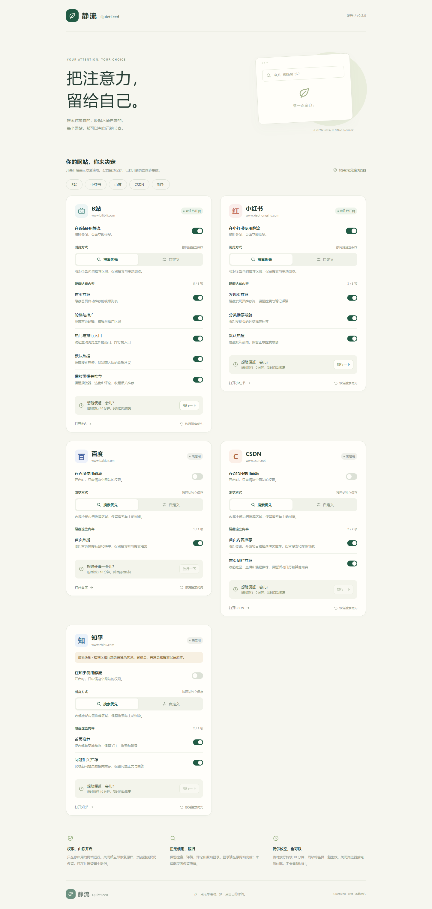
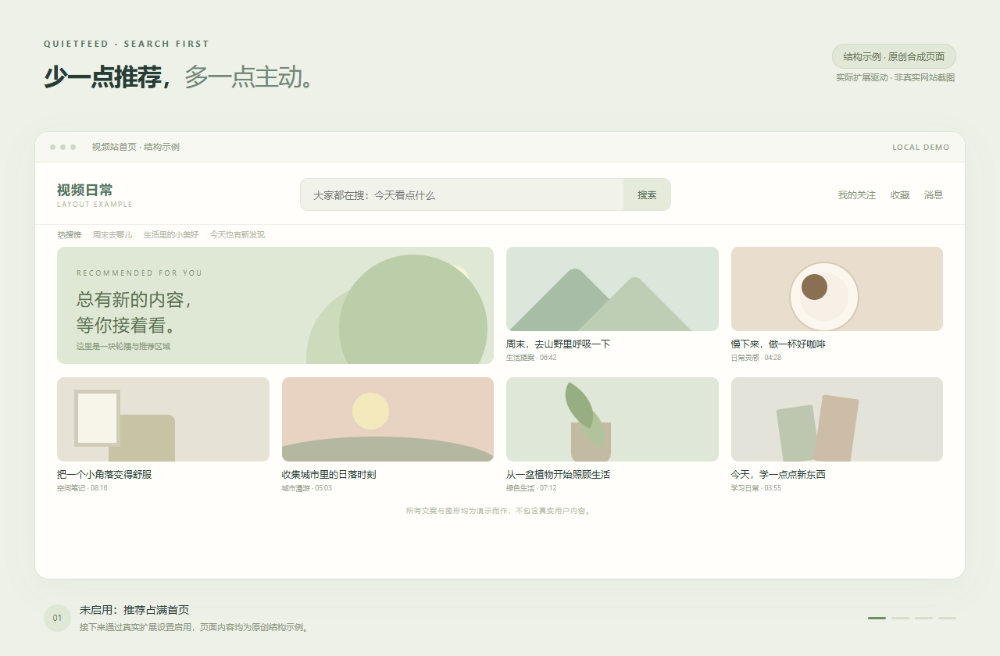
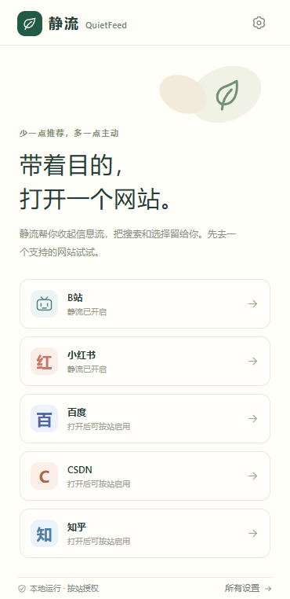

# 静流 QuietFeed

**带着问题来，带着答案走。**

让常用网页回到搜索优先：按网站收起指定的推荐、热搜和相关推荐，保留你主动打开的内容。v0.2.0 在哔哩哔哩、小红书之外加入百度首页、CSDN 首页与知乎试验适配。

[English](README.en.md) · [安装与使用](docs/USER_GUIDE.md) · [验证记录](docs/VERIFICATION.md) · [发布到 GitHub](docs/PUBLISH.md) · [隐私说明](PRIVACY.md)

[下载 Chrome 版](https://github.com/boxuanzou468-blip/quietfeed/releases/download/v0.2.0/quietfeed-0.2.0-chrome.zip) · [下载 Edge 版](https://github.com/boxuanzou468-blip/quietfeed/releases/download/v0.2.0/quietfeed-0.2.0-edge.zip) · [全部版本](https://github.com/boxuanzou468-blip/quietfeed/releases) · [反馈问题](https://github.com/boxuanzou468-blip/quietfeed/issues)

[](https://github.com/boxuanzou468-blip/quietfeed/actions/workflows/ci.yml)





截图展示 v0.2 五站设置页。动图使用明确标注的原创结构示例，由真实扩展驱动；不作为真实网站兼容性证明。

## 它能做什么

- **搜索优先：** 收起首页推荐和默认热搜；保留搜索结果、主动打开的视频或笔记。
- **五个网站分别设置：** 启用状态、隐藏模块、临时放行互不影响；知乎在界面中明确标为试验适配。
- **固定模块，可随时调整：** 关闭某个模块的隐藏开关，即可恢复这部分内容。
- **临时放行 10 分钟：** 当前网站暂时显示原页面，到期恢复隐藏，也可以提前结束。
- **默认关闭，按需授权：** 五站安装后都关闭；在启用相应站点时只请求该站点的准确域名权限。
- **数据留在本机：** 不需要账号，不接入云服务、AI 或分析统计。

支持 Chrome、Edge 的桌面版本。它改变网页中指定区域的显示，不负责阻止网站请求，也不控制手机 App。

| 网站         | 本版适配范围                                                           | 保留的页面与限制                                                               |
| ------------ | ---------------------------------------------------------------------- | ------------------------------------------------------------------------------ |
| 哔哩哔哩     | 首页推荐、轮播与推广、热门与排行入口、默认热搜、播放页相关推荐         | 保留播放器、选集、评论；搜索、动态和个人空间所在的其他子域不注入               |
| 小红书       | 发现页推荐、分类推荐导航、默认热搜                                     | 保留搜索结果、笔记详情、评论、个人主页、消息与登录流程                         |
| 百度         | 仅首页热搜                                                             | 搜索框与输入后的联想保留；搜索结果页保留原样，未加入结果页侧栏规则             |
| CSDN         | 首页资讯标题/头条/轮播链接、开源项目、精选博客；右侧社区/直播/课程推荐 | 保留搜索入口、侧栏导航和含 iframe 的广告；博客文章、代码、目录、评论不注入适配 |
| 知乎（试验） | 首页推荐、问题页侧栏相关推荐                                           | 保留搜索、问题与回答正文、评论、关注、个人页和收藏；专栏不注入；**待登录实测** |

每站仅申请一个准确的 `www` 域名，其他子域不会因启用该站而获得访问权限。百度结果页、CSDN 博客文章和知乎专栏均不属于新增隐藏范围。知乎真实访问遇到登录跳转或 HTTP 403，当前规则不能视为已经通过登录态验收。各站证据见 [百度](docs/evidence/baidu.md)、[CSDN](docs/evidence/csdn.md)、[知乎](docs/evidence/zhihu.md) 和 [验收清单](docs/VALIDATION.md)。

## 安装

当前以解压加载扩展的方式使用。从仓库的 [Releases](https://github.com/boxuanzou468-blip/quietfeed/releases) 页面下载以下文件；本地也可以运行 `npm run release` 生成到 `artifacts/`：

- `quietfeed-0.2.0-chrome.zip`：Chrome 扩展包。
- `quietfeed-0.2.0-edge.zip`：Edge 扩展包。
- `quietfeed-0.2.0-source.zip`：对应版本的源码。
- `SHA256SUMS.txt`：文件校验值。

扩展 ZIP 需要先解压，再选择包含 `manifest.json` 的目录；不要直接把 ZIP 当作商店扩展安装。

1. 下载对应浏览器的 ZIP，解压到一个准备长期保留的文件夹。
2. 打开 `chrome://extensions` 或 `edge://extensions`，打开“开发者模式”。
3. 点击“加载已解压的扩展”，选择解压后包含 `manifest.json` 的文件夹。
4. 将静流固定到工具栏，打开扩展设置，启用需要的网站并确认浏览器的站点授权。
5. 打开或刷新相应网站，检查需要隐藏的模块。

也可以按下面的开发步骤从源码构建；Chrome 加载 `.output/chrome-mv3`，Edge 加载 `.output/edge-mv3`。



## 三个常用操作

**关闭一个网站：** 关闭该网站的启用开关，恢复原页面显示。权限是否仍获准由浏览器管理；可以在扩展详情中撤销。

**只恢复某一类内容：** 在设置页关闭对应模块的隐藏开关。例如恢复播放页相关推荐，同时继续隐藏首页推荐。更改后进入自定义模式。

**暂时完整浏览：** 点击“放行一下”，暂时恢复原页面 10 分钟。它对该网站的已授权页面生效，其他网站继续保持原设置；到期后自动恢复，也可点击“提前结束”。

完整说明见 [用户指南](docs/USER_GUIDE.md)。本版使用内置适配规则，没有自由点选元素、规则分享、云同步或账号系统。

## 当前验收状态

此表区分本地验证与真实网站验证。只有实际完成对应步骤后，才应更新为通过；登录态验证需要使用者在自己的浏览器内操作。

| 验收项目                              | 当前状态         | 证据/说明                                                                                                   |
| ------------------------------------- | ---------------- | ----------------------------------------------------------------------------------------------------------- |
| v0.2 单元、静态、类型与浏览器样例测试 | 通过             | 122 项单元测试；Chrome 13 项、Edge 新增功能 5 项集成测试，均为样例验证；见 [验证记录](docs/VERIFICATION.md) |
| v0.2 Chrome / Edge 构建及打包         | 通过             | 两个浏览器构建、扩展 ZIP、源码 ZIP 及逐项内容校验                                                           |
| B 站与小红书的历史真实网页测试        | 保留 v0.1 记录   | B 站中文区域首页部分通过；小红书最后一轮受风控，较早 Edge 轮次验证了两个发现页区域；不等同 v0.2 复测        |
| 百度真实页面                          | 首页指定区域通过 | Chrome/Edge 均完成热搜隐藏、恢复、撤权与搜索聚焦；搜索结果页未纳入                                          |
| CSDN 真实页面                         | 首页指定区域通过 | Chrome/Edge 均完成 10 个指定节点隐藏与恢复，搜索聚焦和撤权通过；文章页不注入                                |
| 知乎真实网页                          | 试验，待登录实测 | 登录跳转或 HTTP 403；未证明真实推荐节点隐藏正确                                                             |
| 五站已登录状态与原生授权弹窗          | 未完成整体验收   | 需在本机实际操作，不上传账号数据                                                                            |
| v0.2 Chrome / Edge 手工加载           | 待本轮验收       | 分别检查权限、启停和恢复                                                                                    |

本地测试通过不等同于真实网站和全部登录状态已经通过。遇到结构变化时，先关闭受影响模块或站点，再按 [反馈指南](CONTRIBUTING.md) 描述问题。

历史自动化效果测试使用隔离配置中的测试预授权，原生授权弹窗仍需人工验收。新增站点的结构探测与本地样例测试分别记录，不据此声称所有页面已经可用。[完整验证范围](docs/VERIFICATION.md)。远端检查结果见 [GitHub Actions](https://github.com/boxuanzou468-blip/quietfeed/actions)。

## 本地开发

需要 Node.js 22.12 或更新版本；CI 使用 Node.js 24。使用 npm 和提交的锁文件。

```sh
npm ci
npm run dev
```

```sh
npm run dev:edge
npm run lint
npm run typecheck
npm test
npm run build
npx playwright install chromium
npm run test:e2e
npm run release
```

`npm run release` 构建两个浏览器版本，并在 `artifacts/` 生成扩展包、源码包和校验文件。开发说明见 [CONTRIBUTING.md](CONTRIBUTING.md)。

## 开源

采用 [MIT 许可证](LICENSE)。欢迎提交可复现的网页适配问题、修复和测试。贡献前请阅读 [贡献指南](CONTRIBUTING.md)；请勿提交账号信息、浏览记录或含个人内容的截图。
